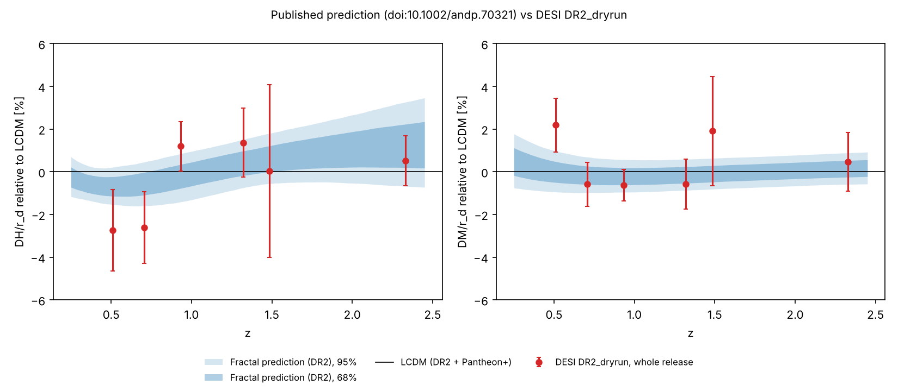

# Published prediction vs DESI DR2_dryrun

Prediction: [doi:10.1002/andp.70321](https://doi.org/10.1002/andp.70321), Section 11 and Table 15, frozen in [`prediction/`](../prediction/) (see [`PREDICTION.md`](../PREDICTION.md)). Data: `desi_dr2_mean.txt`, `desi_dr2_cov.txt`.

## Result

**New data only (the test):** not available: the release carries no information beyond DR2 (is it DR2 itself?).

**Whole release (reference, contains DR2):** The data are consistent with the published prediction. They moderately prefer the fractal model over LCDM. (Delta chi2 = -2.27, 0 of 13 points off at 95%.)



## Measurements (whole release)

| z | Observable | Measured | Fractal prediction (95%) | LCDM prediction | Pull vs fractal | Consistent |
|---|---|---|---|---|---|---|
| 0.295 | D_V/r_d | 7.942 ± 0.076 | 7.938 [7.857, 8.024] | 7.931 | +0.04 | yes |
| 0.510 | D_M/r_d | 13.588 ± 0.168 | 13.295 [13.171, 13.426] | 13.297 | +1.62 | yes |
| 0.510 | D_H/r_d | 21.863 ± 0.429 | 22.323 [22.134, 22.527] | 22.480 | -1.04 | yes |
| 0.706 | D_M/r_d | 17.351 ± 0.180 | 17.425 [17.283, 17.574] | 17.454 | -0.38 | yes |
| 0.706 | D_H/r_d | 19.455 ± 0.334 | 19.868 [19.660, 20.068] | 19.978 | -1.18 | yes |
| 0.934 | D_M/r_d | 21.576 ± 0.162 | 21.666 [21.503, 21.835] | 21.712 | -0.49 | yes |
| 0.934 | D_H/r_d | 17.641 ± 0.201 | 17.399 [17.188, 17.581] | 17.434 | +1.08 | yes |
| 1.321 | D_M/r_d | 27.601 ± 0.325 | 27.717 [27.518, 27.921] | 27.759 | -0.34 | yes |
| 1.321 | D_H/r_d | 14.176 ± 0.225 | 14.039 [13.879, 14.197] | 13.985 | +0.57 | yes |
| 1.484 | D_M/r_d | 30.512 ± 0.764 | 29.910 [29.696, 30.129] | 29.941 | +0.78 | yes |
| 1.484 | D_H/r_d | 12.817 ± 0.518 | 12.891 [12.742, 13.044] | 12.814 | -0.14 | yes |
| 2.330 | D_H/r_d | 8.632 ± 0.101 | 8.686 [8.529, 8.867] | 8.587 | -0.41 | yes |
| 2.330 | D_M/r_d | 38.989 ± 0.532 | 38.860 [38.581, 39.153] | 38.810 | +0.23 | yes |

## Details

```
SURVIVES: consistent with the published prediction (goodness of fit p = 0.814; 0 of 13 points off at 95%).
Fractal vs LCDM: Delta chi2 = -2.27 (likelihood ratio 3.1), moderate support for the fractal prediction over LCDM. In simulations, a value this high or higher occurs 52% of the time if the fractal model is true; this low or lower 8% of the time if LCDM is true.
Paper's sign test did not fire (in simulations it fires 8% of the time if the fractal model is true and 23% if LCDM is true, so on its own it is weak evidence).
```

Full numbers are in the JSON report next to this file.
