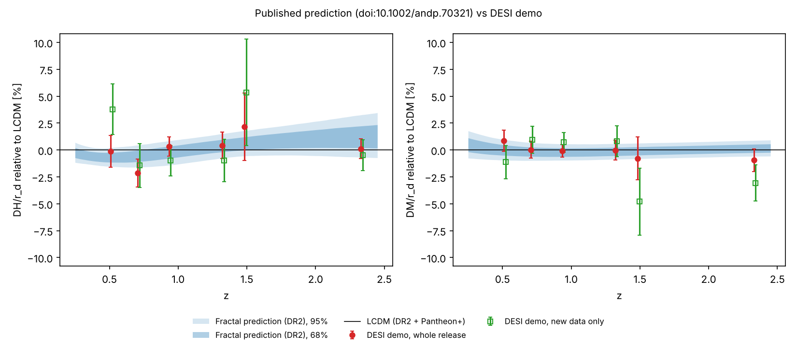

# Published prediction vs DESI demo

Prediction: [doi:10.1002/andp.70321](https://doi.org/10.1002/andp.70321), Section 11 and Table 15, frozen in [`prediction/`](../prediction/) (see [`PREDICTION.md`](../PREDICTION.md)). Data: `mock_lcdm_mean.txt`, `mock_lcdm_cov.txt`.

> **This is a mock release** (real DR2 plus simulated new data), made to show what the output looks like. It is not real DESI data.

## Result

**New data only (the test):** The data are consistent with the published prediction. They moderately prefer LCDM over the fractal model. (Delta chi2 = +2.89, 1 of 13 points off at 95%.)

**Whole release (reference, contains DR2):** The data are consistent with the published prediction. They do not clearly prefer either model yet. (Delta chi2 = +0.90, 0 of 13 points off at 95%.)



## Measurements (new data only)

| z | Observable | Measured | Fractal prediction (95%) | LCDM prediction | Pull vs fractal | Consistent |
|---|---|---|---|---|---|---|
| 0.295 | D_V/r_d | 7.734 ± 0.093 | 7.938 [7.857, 8.024] | 7.931 | -1.99 | no |
| 0.510 | D_M/r_d | 13.148 ± 0.206 | 13.295 [13.171, 13.426] | 13.297 | -0.68 | yes |
| 0.510 | D_H/r_d | 23.332 ± 0.525 | 22.323 [22.134, 22.527] | 22.480 | +1.89 | yes |
| 0.706 | D_M/r_d | 17.621 ± 0.220 | 17.425 [17.283, 17.574] | 17.454 | +0.84 | yes |
| 0.706 | D_H/r_d | 19.690 ± 0.409 | 19.868 [19.660, 20.068] | 19.978 | -0.42 | yes |
| 0.934 | D_M/r_d | 21.868 ± 0.198 | 21.666 [21.503, 21.835] | 21.712 | +0.93 | yes |
| 0.934 | D_H/r_d | 17.260 ± 0.246 | 17.399 [17.188, 17.581] | 17.434 | -0.52 | yes |
| 1.321 | D_M/r_d | 27.983 ± 0.397 | 27.717 [27.518, 27.921] | 27.759 | +0.65 | yes |
| 1.321 | D_H/r_d | 13.849 ± 0.275 | 14.039 [13.879, 14.197] | 13.985 | -0.66 | yes |
| 1.484 | D_M/r_d | 28.501 ± 0.935 | 29.910 [29.696, 30.129] | 29.941 | -1.50 | yes |
| 1.484 | D_H/r_d | 13.500 ± 0.634 | 12.891 [12.742, 13.044] | 12.814 | +0.95 | yes |
| 2.330 | D_H/r_d | 8.545 ± 0.124 | 8.686 [8.529, 8.867] | 8.587 | -0.94 | yes |
| 2.330 | D_M/r_d | 37.618 ± 0.651 | 38.860 [38.581, 39.153] | 38.810 | -1.86 | yes |

## Details

```
SURVIVES: consistent with the published prediction (goodness of fit p = 0.131; 1 of 13 points off at 95%).
Fractal vs LCDM: Delta chi2 = +2.89 (likelihood ratio 0.24), moderate support for LCDM over the fractal prediction. In simulations, a value this high or higher occurs <1% of the time if the fractal model is true; this low or lower 97% of the time if LCDM is true.
Paper's sign test FIRED (in simulations it fires 9% of the time if the fractal model is true and 24% if LCDM is true, so on its own it is weak evidence).
```

Full numbers are in the JSON report next to this file.
